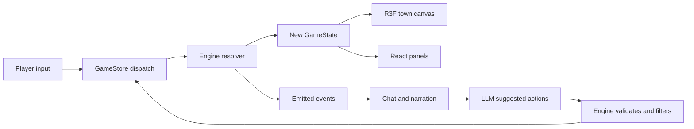

# Architecture

Companion to [`docs/rulebook.md`](rulebook.md). The rulebook is the design source of truth; this
file records the technical decisions and the boundaries between packages.

## Stack

| Concern | Choice | Notes |
| --- | --- | --- |
| Language | TypeScript, strict | `noUncheckedIndexedAccess`, `exactOptionalPropertyTypes` |
| Package manager | pnpm workspaces | three packages: `engine`, `data`, `ui` |
| Build / dev server | Vite | UI only; engine and data are plain TS libraries |
| Validation | Zod | Registries on load, LLM structured output, save files |
| Tests | Vitest | Engine unit tests + headless simulation tests |
| 3D rendering | three.js via `@react-three/fiber` | Town canvas, lighting, camera |
| 2D UI | React | Property website, HUD, chat, bank ledger |
| State bridge | Zustand | Single `GameStore` owning engine state |
| LLM | OpenAI-compatible HTTP client | Base URL from `LLM_BASE_URL` |

## Package boundaries

```
packages/
  engine/   pure TS. No DOM, no React, no three, no zustand.
  data/     JSON registries + Zod schemas + map geometry generation.
  ui/       Vite + React + R3F. Consumes engine and data.
```

The engine boundary is enforced with ESLint `no-restricted-imports` in `packages/engine`:

```jsonc
// packages/engine/.eslintrc.cjs
"no-restricted-imports": ["error", {
  "patterns": ["react", "react-dom", "three", "@react-three/*", "zustand", "pixi.js"]
}]
```

This is what keeps headless simulation honest. If the engine cannot import a renderer, it cannot
accidentally depend on one.

## Engine internals

```
packages/engine/src/
  state/       GameState type, initial state factory, turn loop
  resolver/    expression evaluator, d100 roll, effect application, ripple rules
  actions/     action registry, precondition checks, action handlers
  systems/     property, loans, tenancy, planning, rivals, cards, events
  rng/         seeded PRNG (mulberry32 or xoshiro128**)
  events/      emitted event union type
  sim/         headless runner for balance testing
```

### The core loop

Every player or rival action goes through one function:

```ts
function resolve(state: GameState, action: Action, rng: Rng): Resolution
```

`Resolution` contains the next `GameState` and an ordered list of `GameEvent`s. Nothing mutates
state in place. This makes replay, undo, save/load and simulation all fall out for free.

### Resolution pipeline

Mirrors rulebook section 2.5 exactly:

1. `checkPreconditions` — cash, AP, valid target, not blocked.
2. `computeSuccessChance` — expression evaluated against actor and target stats.
3. `applyCardBonus` — if a card was played.
4. `roll` — d100, success when `roll <= chance`.
5. `applyEffects` — costs always, then success or failure branch.
6. `applyRipples` — persona stat changes, memory log entries, cascade checks.
7. `emit` — events for the UI, chat and narration layers.

### Expression evaluator

Success chances are data, not code. Each action in the registry carries a formula string such as:

```
base + trust * 0.5 - suspicion * 0.4 + (offer - greedPrice) / 1000
```

The evaluator is a small, sandboxed arithmetic parser (no `eval`, no `Function`). It supports
numbers, identifiers resolved from a context object, `+ - * /`, parentheses and `min`/`max`/`clamp`.
Formulas are validated at load time by parsing them once, so a typo in a registry entry fails fast.

### Seeded RNG

A single `Rng` instance is threaded through the whole game. The seed is stored in `GameState`, so a
save file reproduces the exact same run. Headless simulation runs thousands of seeds.

## Data package

```
packages/data/
  schemas/     Zod schemas for every registry
  registries/  properties.json, personas.json, actions.json, events.json, cards.json
  map/         town-square.json, district-seeds.json, generator.ts
```

### Map model

The map is not a tile grid. It is:

- **Road splines** — Catmull-Rom curves with width and district tags.
- **Plots** — polygons with `plotId`, `address`, `district`, `area`, `frontageEdge`.
- **Landmarks** — the town square anchor: town hall, clock tower, park with fountain, police
  station, fire station. Non-ownable, always present, and the location of the personas.
- **Districts** — four regions seeded from authored points, partitioned by Voronoi.

Authoring split:

| Element | Authored or generated |
| --- | --- |
| Town square layout and landmarks | Authored JSON |
| District seed points and buyer types | Authored JSON |
| Road splines | Generated from seed |
| Plot subdivision and shapes | Generated from seed |
| Building style variants | Generated from seed + refurbishment level |

Generation is deterministic: same seed, same town. The generator lives in `packages/data/map/` and
outputs a `TownMap` object validated by Zod.

**Geometry isolation:** the engine only ever sees `plotId`, `district` and `area`. Polygons, splines
and meshes never enter `GameState`. This keeps the headless sim free of spatial code and lets the
renderer change without touching rules.

## UI package

```
packages/ui/src/
  canvas/      TownCanvas, RoadMesh, PlotMesh, BuildingMesh, LandmarkMesh, lighting, camera
  panels/      PropertyWebsite, Hud, ChatWindow, BankLedger, ContextMenu, ActionBar
  store/       GameStore (Zustand), selectors, dispatch bridge
  llm/         client, prompt builders, suggested-action filtering
  app/         App shell, layout, routing between canvas and panels
```

### Rendering

- One `TownCanvas` component owns the R3F `<Canvas>`, lighting rig and camera controls.
- Roads render as extruded ribbon geometry from the splines.
- Plots render as flat polygons; owned plots get an owner tint via material colour.
- Buildings render as extruded footprints with a style variant per refurbishment level.
- Refurbishment shows scaffolding; development shows a construction state.
- Clicking a mesh dispatches `selectPlot(plotId)` to the store, which opens the context menu built
  from the action registry.

### State bridge

`GameStore` holds the current `GameState` and the event log. It exposes:

```ts
dispatch(action: Action): void
```

which calls `resolve` from the engine and swaps in the new state. React components subscribe to
slices. The canvas and the panels read the same state, so a purchase made in the property website
immediately retints the building on the map.

### LLM layer

The LLM is strictly downstream of the engine:

1. Build a prompt from persona stats, mood, memory log and the current situation.
2. Ask for a reply plus a list of suggested action ids.
3. Validate the response with Zod.
4. Filter suggested actions through `checkPreconditions` — only valid ones become buttons.
5. A button click dispatches the normal action through the resolver.

If the LLM returns garbage or nothing, the standard action buttons are still rendered. The game is
fully playable with the LLM switched off.

## Data flow



## Testing strategy

- **Unit tests** per resolver rule: preconditions, chance formulas, effect application, ripples.
- **Registry tests**: every JSON entry parses against its Zod schema and every formula parses.
- **Map tests**: generation is deterministic for a given seed and produces a connected road graph
  with no overlapping plots.
- **Simulation tests**: headless runs of 40 turns across many seeds, asserting no crashes, no
  negative-cash states without bankruptcy, and win-rate within a target band.
- **UI smoke tests**: canvas mounts, a plot click opens the context menu, a purchase updates state.

## Configuration

| Variable | Purpose |
| --- | --- |
| `LLM_BASE_URL` | OpenAI-compatible endpoint |
| `LLM_API_KEY` | Optional, for hosted endpoints |
| `LLM_MODEL` | Model name |
| `VITE_MAP_SEED` | Seed for town generation in dev |

All read through a single validated config module so a missing variable fails loudly at startup.
